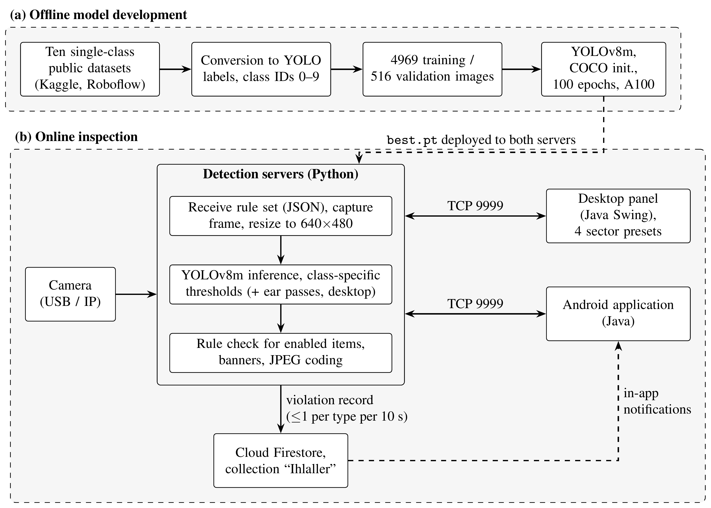
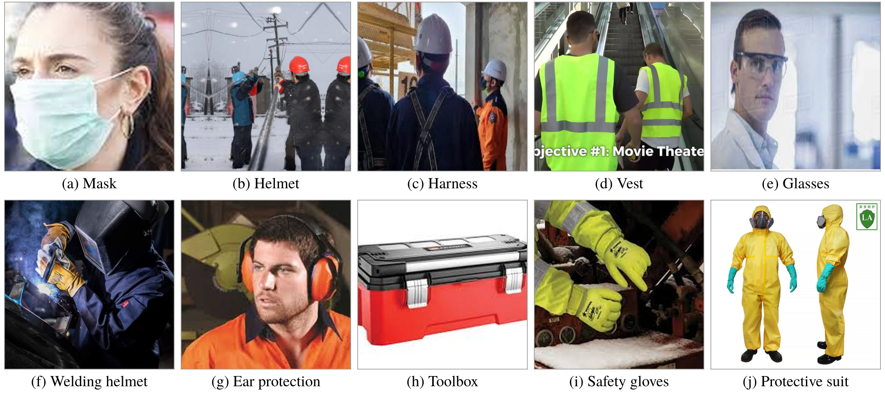
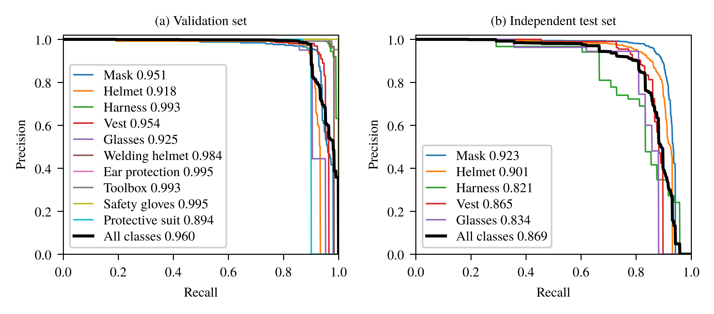

# PPE Monitoring Prototype with YOLOv8, Desktop and Mobile Clients

This repository contains the code, training notebooks, training logs and evaluation scripts of the study

> Ö. Z. Özçelik, A. B. Köse, T. Aydoğan, *A YOLOv8-Based Prototype for Sector-Specific Personal Protective Equipment Monitoring with Desktop and Mobile Interfaces* (manuscript submitted to Uludağ University Journal of the Faculty of Engineering).

The system was developed as an undergraduate thesis project in the Department of Computer Engineering, Isparta University of Applied Sciences. A YOLOv8m detector recognises ten safety-related items, a Python server checks the items that the user has selected for the monitored area and streams annotated frames to a Java desktop panel or an Android application, and every violation is logged in Cloud Firestore.

*Türkçe özet:* Bu depo, yapay zekâ tabanlı iş sağlığı ve güvenliği (KKD) denetim sistemine ait sunucu, masaüstü ve mobil istemci kodlarını, model eğitim defterlerini, eğitim kayıtlarını ve değerlendirme betiklerini içerir.



This repository is a cleaned-up and extended release of the original project repository of the first author, [ozgezaraozcelik/Yapay_Zeka_Destekli_ISG_Kontrol_Sistemi](https://github.com/ozgezaraozcelik/Yapay_Zeka_Destekli_ISG_Kontrol_Sistemi). Compared with it, the servers and folders were renamed, the first (five-class) model and the training outputs were added, and the evaluation scripts used in the paper were included.



## Detected classes

| ID | Class | Sector preset (desktop client) |
|---:|---|---|
| 0 | mask | Chemical & laboratory |
| 1 | helmet | Construction |
| 2 | belt (safety harness) | Construction |
| 3 | vest | Construction, logistics |
| 4 | glasses | Chemical & laboratory |
| 5 | welding_helmet | Heavy industry & welding |
| 6 | ear_protection | Heavy industry & welding |
| 7 | toolbox | Logistics |
| 8 | safety_gloves | Heavy industry & welding |
| 9 | protective_suit | Chemical & laboratory |

## Repository structure

```
ai_server/                  Python detection servers (Ultralytics YOLOv8 + OpenCV + Firebase Admin)
  detector_server_desktop.py   server for the Java desktop client (exact class matching, extra ear passes)
  detector_server_mobile.py    server for the Android client (JPEG quality 50, reconnect loop)
  live_test.py                 stand-alone webcam test without a client
desktop_app/                Java Swing control panel (SafetyApp.java) with four sector presets
mobile_app/ISG_2/           Android Studio project (Java)
training/
  v1_five_classes/          first-semester model (5 classes): notebooks, args.yaml, results.csv, plots
  v2_ten_classes/           second-semester model (10 classes): notebook, validation-set script, parsed log,
                            Ultralytics run outputs (results.csv, args.yaml, PR/F1 curves, confusion matrices)
evaluation/                 overlap analysis, subset re-evaluation and CPU timing scripts with their outputs
data/                       dataset sources, licences and the data.yaml template
models/                     where to obtain the trained weights
docs/                       figures and screenshots used in the paper
```

## Results (10-class model)

| Evaluation | Precision | Recall | mAP@0.5 | mAP@0.5:0.95 |
|---|---:|---:|---:|---:|
| Validation set, all ten classes (516 images, 1236 objects; training log) | 0.973 | 0.943 | 0.969 | 0.833 |
| Independent test set, five original classes (446 images, 1649 objects) | 0.915 | 0.794 | 0.869 | 0.542 |

**Important:** 431 of the 516 validation images are copies of training images, including all validation images of the five added classes, so the validation values are optimistic. The independent test set (images of the five-class dataset that were never used for training) gives a more realistic estimate for mask, helmet, harness, vest and glasses; for the five added classes no independent images were available. Details and class-wise values: `evaluation/README.md`.



## Installation

```bash
git clone https://github.com/ahmetbestamikose/monitoring-system-ppe.git
cd monitoring-system-ppe/ai_server
python -m venv venv
source venv/bin/activate          # Windows: venv\Scripts\activate
pip install -r requirements.txt
```

1. Copy `.env.example` to `.env` and adjust host, port and model paths if needed.
2. To log violations in the cloud, create a Firebase project, download a service-account key and save it as `ai_server/firebase-adminsdk.json` (see `firebase-adminsdk.example.json`). Without this file the servers run in local mode.
3. Put the trained weights (`best.pt`, see `models/README.md`) into `ai_server/`. `yolov8n.pt` is downloaded automatically by Ultralytics on first use.

## Running

```bash
# desktop setup
python ai_server/detector_server_desktop.py      # then start the client:
javac desktop_app/SafetyApp.java && java -cp desktop_app SafetyApp

# mobile setup
python ai_server/detector_server_mobile.py       # then run the Android app (mobile_app/ISG_2) from Android Studio
```

Both servers listen on TCP port 9999 and serve one client at a time. In each cycle the client sends a length-prefixed JSON rule set (`{"check_helmet": true, ...}`) and the server replies with a length-prefixed annotated JPEG frame (the desktop server sends an additional message with the list of active violations). In `MainActivity.java`, set `SERVER_IP` to `10.0.2.2` for the Android emulator or to the LAN address of the server computer for a real phone.

## Reproducing the training

The notebooks in `training/` were run on Google Colab with an NVIDIA A100 GPU (Ultralytics 8.3.246 for the five-class model, 8.4.56 for the ten-class model). Rebuild the dataset from the sources listed in `data/README.md`, adjust the paths in `data.yaml` and run the training cell (`yolov8m.pt`, 100 epochs, image size 640; batch 16 for v1 and 32 for v2).

## Known limitations

- **Train/validation overlap** (see above): the near-perfect scores of the added classes were obtained on copies of training images and do not reflect performance on new images.
- **Mask class:** the face-mask source labels faces *with*, *without* and *incorrectly worn* masks; all three were mapped to `mask` (the 853 source images carry 4072 `mask` boxes: 3232 with a mask, 717 without and 123 incorrectly worn). The mask check therefore does not distinguish masked from unmasked faces until the labels are corrected and the model is retrained.
- **Partial annotation:** each image is annotated only for the class of its source dataset.
- **Frame-level rules:** an item is considered present if it is detected anywhere in the frame; detections are not assigned to individual workers. `yolov8n.pt` is loaded by the servers but not used yet.
- **Mobile server class matching:** the version used in the paper's laboratory tests matched class names by substring, so a detected `welding_helmet` also satisfied the helmet rule. This release uses exact class names in both servers (`RULE_CLASSES` in `detector_server_mobile.py`).
- **Ear threshold (desktop server):** the 0.01 threshold for `ear_protection` never takes effect, because each pass first applies its confidence pre-filter (0.10 in the main pass, 0.03 in the two extra 960-px passes).
- **Servers and ports:** both servers listen on port 9999 by default (`PORT` environment variable); they are alternatives and are not meant to run on the same computer at the same time.
- **Demonstration fields:** the personnel list, the personnel/region/accuracy fields and the evidence thumbnails in the desktop violation history are fixed demonstration values.
- **Mobile notifications:** the Firestore-based notification and violation list shown in the paper's screenshots belong to an app version that is not part of `mobile_app/` in this release.

## Data and model licences

The datasets are not redistributed here; `data/README.md` lists the original sources and their licences. The reference images in `desktop_app/assets/kanit/` are taken from the training sources and are used only as illustrations in the user interface. The code depends on [Ultralytics YOLOv8](https://github.com/ultralytics/ultralytics), which is licensed under AGPL-3.0; this repository is released under the same licence (see `LICENSE`).

## Citation

If you use this repository, please cite the paper (citation details will be added after publication) or use the metadata in `CITATION.cff`.

## Acknowledgements

We thank the jury members of the thesis, Assoc. Prof. Dr. Serap Ergün and Asst. Prof. Dr. Gamzepelin Aksoy, and Fatih Güler for mentoring the first author during the project.
